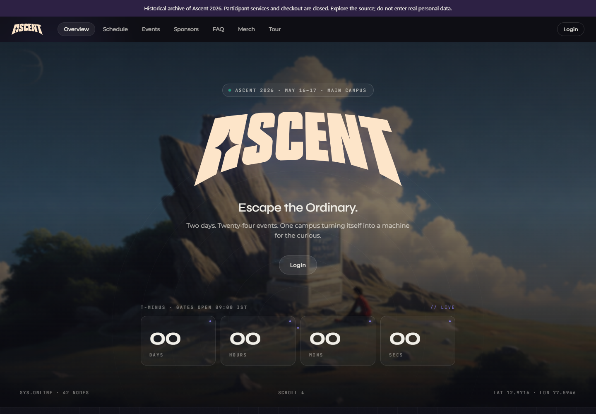
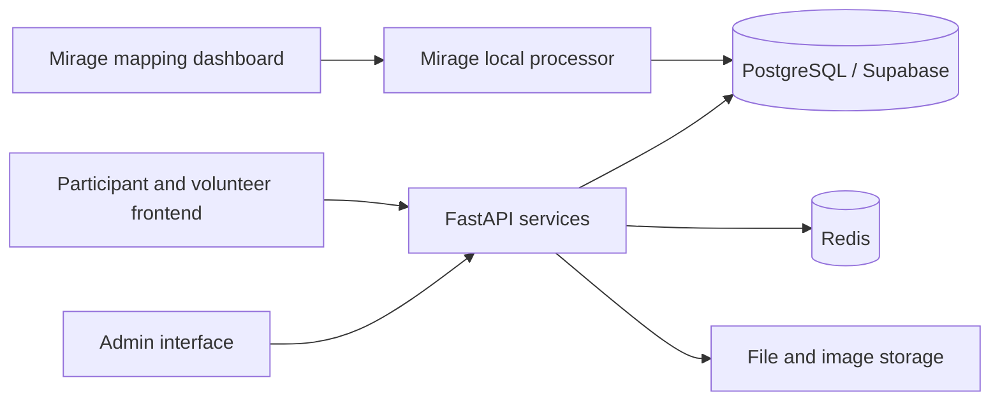
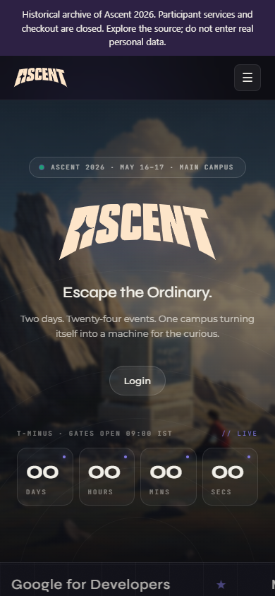

<p align="center"></p>

# Ascent Dashboard

**One event, many moving parts: participants, teams, submissions, QR entry, volunteers and a shared leaderboard.**

Ascent Dashboard brought those workflows into one platform for Ascent 2026 at Scaler School of Technology. This repository preserves the team's implementation as a historical source archive, with operational records and private configuration removed from its published history.

[Explore the source](#inside-the-platform) · [My contribution](#a-team-project) · [Preview locally](#preview-the-public-frontend) · [Archive notes](ARCHIVE_NOTES.md)



*A real capture of the public frontend, using its bundled event artwork. The original promotional copy is historical, not verified usage or adoption evidence. Participant services are disconnected.*

## Inside the platform

| Part | What the team built |
| --- | --- |
| Participant experience | Event discovery, teams, registration, submissions, schedules and account flows |
| Event operations | Admin tools, QR validation, volunteer/booth workflows, announcements and feedback |
| Shared state | FastAPI services, PostgreSQL/Supabase records, Redis caching and leaderboard logic |
| Sidequest | Event coins, activity records and redemption workflows |
| Mirage | Photo-discovery pipeline, local processor, operator mapping/review tools and gallery integration |



This is an implementation record of a team project. The diagram describes its original design; the archive does not provision the former databases, storage, accounts or event deployment.

## A team project

I co-built the platform, with work on the **backend foundation, API/admin workflows, deployment support and caching/leaderboard behavior**. Examples in the retained history include [backend initialization](https://github.com/Muneer320/dashboard/commit/ca07a50), [core routing/admin/rate-limit configuration](https://github.com/Muneer320/dashboard/commit/12bbaa9), [Redis-backed caching](https://github.com/Muneer320/dashboard/commit/e6f637b) and [admin tooling](https://github.com/Muneer320/dashboard/commit/ae61588).

**Mirage's gallery, processor and mapping implementation is credited to X-DIABLO-X, with integration work across the team.** Kartik Dixit, Shambhu Yadav, Sauhard74 and the other contributors recorded in the history retain their work and credits. This is not a claim of sole authorship of the platform or its frontend.

## Preview the public frontend

Use Git and Node.js with npm. The archival build was checked with Node 24 on Windows. From a fresh clone:

```sh
git clone https://github.com/Muneer320/dashboard.git
cd dashboard/frontend
npm ci
npm run build
npm run preview -- --host 127.0.0.1 --port 5177
```

Open **http://127.0.0.1:5177** to explore the landing page, FAQ and historical merchandise display. The page identifies itself as an archive. No account, database, payment destination or team credentials are needed for these public screens. Login, registration, submissions, participant/admin records and Mirage processing require the original services and are not part of this preview. Do not enter real personal data.

<details>
<summary><strong>Phone-sized preview</strong></summary>



</details>

## Archive status and lessons

The event has ended; this copy is retained for architecture, implementation study and contribution context. Publication preserves most project history while removing database/credential exports, operational account seeds, sample identity datasets, private literals and unreviewed attachments. Contributor identities and original dates are retained. The original operational repository is separate and private.

The most useful lessons are in the boundaries: keeping participant/admin state consistent, designing retry-safe QR and submission workflows, adding caching to expensive leaderboard queries, and separating Mirage inference from operator review and publication.

> [!IMPORTANT]
> This is not a deployment template or a current production service. Historical authorization, concurrency and migration-ordering debt remains; the backend has not been re-certified for deployment. The local preview does not prove authentication, database migrations, QR operations or biometric processing work against a fresh service. See the precise [verification and limitations](ARCHIVE_NOTES.md).

Forks are welcome for study and continued work. Review the archive notes before adapting it, use synthetic records, and preserve teammate attribution. No repository-wide team-code license was supplied; no blanket reuse license is asserted here. Third-party dependencies and retained assets keep their own rights and licenses.
