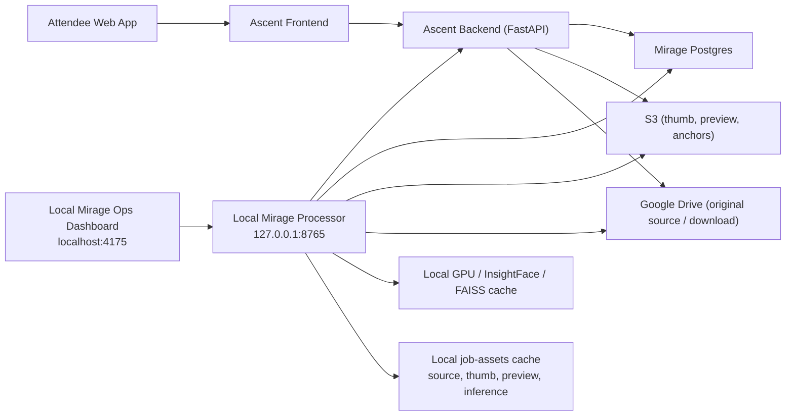
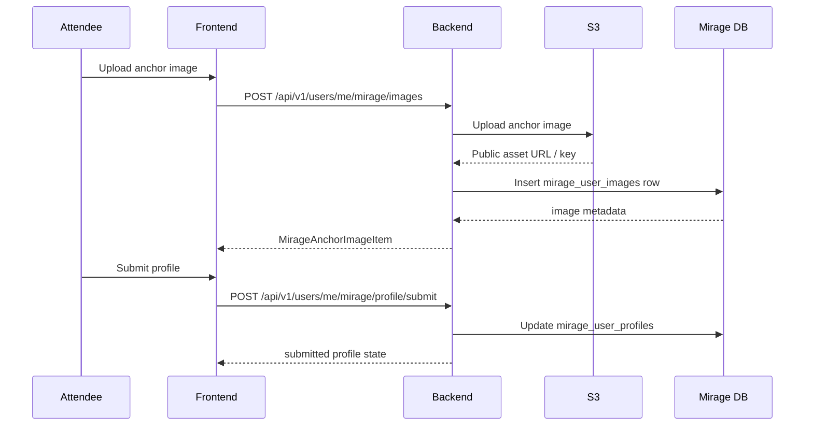
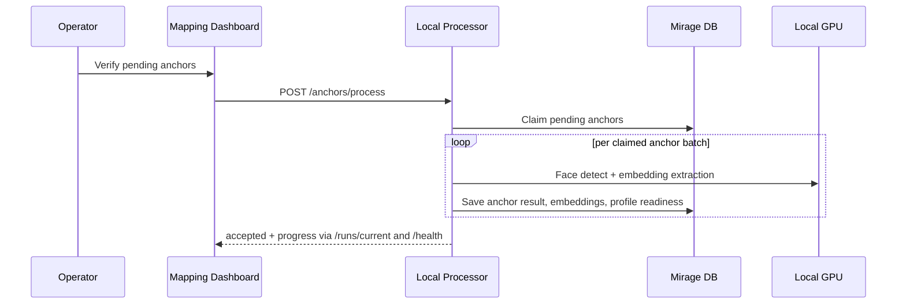
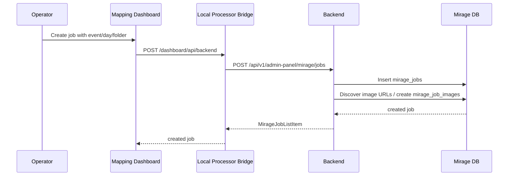
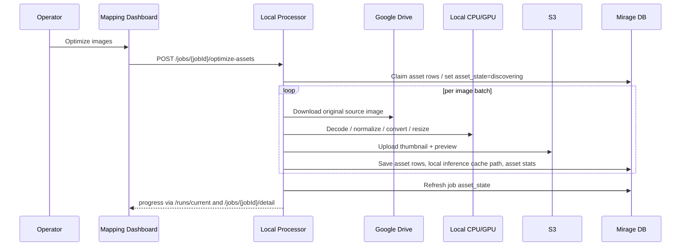
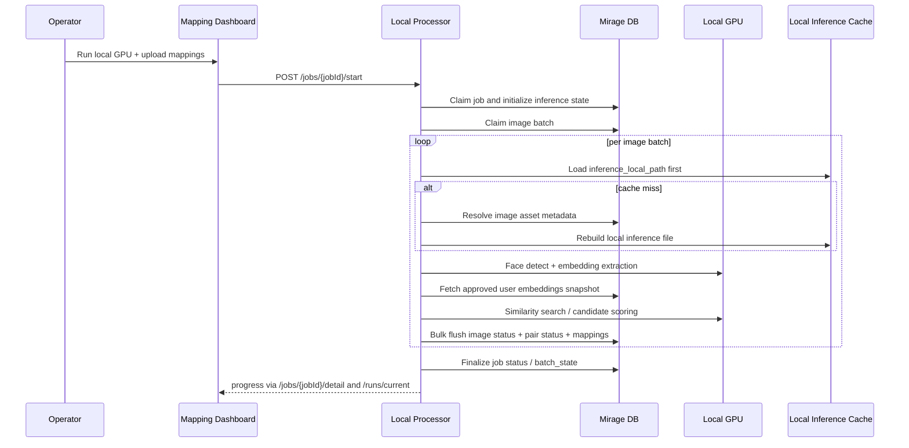
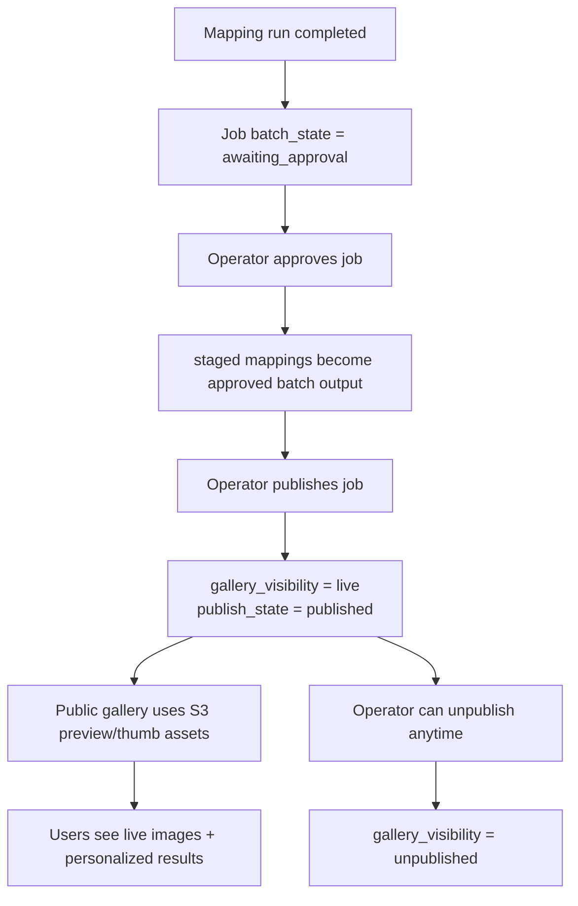
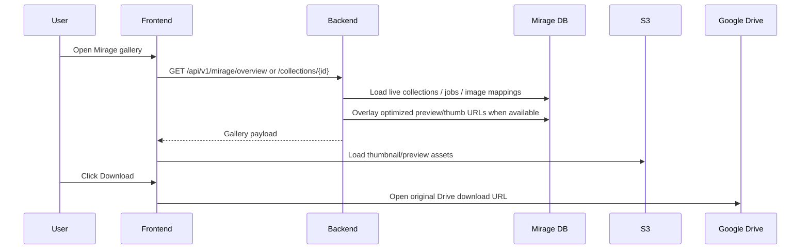
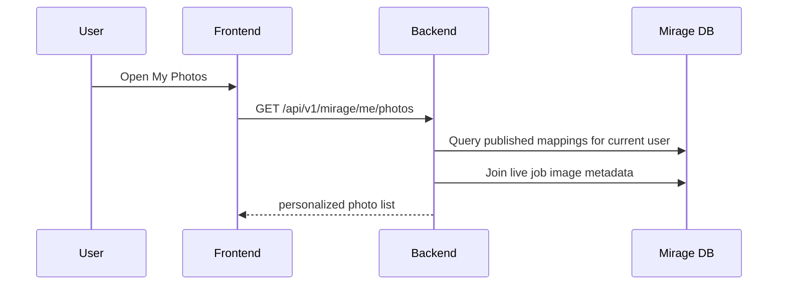
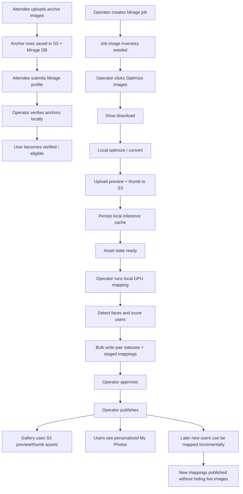

# Mirage High-Level Design (HLD)

**Status:** Draft  
**Last updated:** 2026-05-12  
**Scope:** Mirage attendee enrollment, local processor, local mapping dashboard, admin review/publish lifecycle, public Mirage gallery, personalized gallery, Google Drive ingestion, S3 optimized asset pipeline, and database interactions.

## 1. Executive Summary

Mirage is a hybrid photo-discovery system for event attendees. It combines:

- the deployed **Ascent backend** on `https://ascent.scaler.com`
- the primary **Mirage database** on the VPS-backed Postgres instance
- the public **Mirage gallery** inside the main frontend
- a **local-only mapping dashboard** (`mirage-mapping-dashboard`) used by operators
- a **local-only processor** that runs GPU-based anchor verification, image optimization, and image-to-user matching

Mirage has four major responsibilities:

1. Let attendees upload and manage their own **anchor images**
2. Let operators verify those anchors locally before they become eligible for matching
3. Let operators create a Mirage **job**, optimize source photos, run local inference, review/approve results, and publish them
4. Let users browse the **live gallery** and their personalized **My Photos** results

Mirage intentionally separates:

- **gallery visibility**: whether event photos are live for all users
- **mapping publication**: whether user-photo matches are live
- **local processing**: GPU-heavy work that runs only on the operator machine

This split prevents downtime. Once a job is published, gallery images stay visible until an operator explicitly unpublishes them. Later mapping batches update user-personalized results incrementally.

---

## 2. Scope and Design Goals

### 2.1 Goals

- Keep the public gallery fast and stable
- Keep GPU-heavy processing local to the operator machine
- Avoid repeated Google Drive downloads for repeated mapping runs
- Use optimized S3 assets for public delivery
- Reuse local optimized inference files for local matching
- Make processing observable from the local mapping dashboard
- Support incremental matching for newly verified users without taking down live images

### 2.2 Non-goals

- Running the processor in the deployed backend
- Using the browser directly for privileged Mirage admin actions
- Storing original event photo binaries in S3 for public delivery
- Performing face matching inside the deployed backend request path

---

## 3. System Context

## 3.1 Main Components

1. **Main frontend**
   - path: `D:/HARSHIT/ascent-dashboard/dashboard/frontend`
   - hosts the public Mirage experience for attendees

2. **Main backend**
   - path: `D:/HARSHIT/ascent-dashboard/dashboard/backend`
   - FastAPI app serving Mirage public, user, and admin APIs

3. **Mirage database**
   - direct Postgres used for Mirage-heavy reads/writes
   - configured through `DATABASE_URL` / `MIRAGE_DATABASE_URL`

4. **Local Mirage mapping dashboard**
   - path: `D:/HARSHIT/ascent-dashboard/dashboard/mirage-mapping-dashboard`
   - React + Vite app on `http://localhost:4175`
   - local-only operator UI

5. **Local Mirage processor**
   - local FastAPI service on `http://127.0.0.1:8765`
   - local-only control plane and GPU execution service
   - started from `backend/scripts/start_mirage_processor_server.ps1`

6. **Google Drive**
   - source of original event photos
   - source of original download links for end users

7. **S3**
   - stores optimized `thumbnail` and `preview` event image assets
   - stores Mirage user anchor images

## 3.2 Logical Architecture



---

## 4. Core Domain Model

## 4.1 Main Mirage Entities

### Public gallery entities

- `events`
- `photos`
- `event_photos`
- `trending_photos`
- `photo_likes`
- `photo_like_counts`

### Mirage user entities

- `mirage_user_profiles`
- `mirage_user_images`
- `mirage_user_embeddings`
- `mirage_photo_likes`

### Mirage job / matching entities

- `mirage_jobs`
- `mirage_job_images`
- `mirage_detected_faces`
- `mirage_face_matches`
- `mirage_review_actions`
- `inference_user_image_status`
- `image_user_mappings`

## 4.2 Important State Columns

### Job lifecycle

- `mirage_jobs.status`
- `mirage_jobs.gallery_visibility`
  - `draft`
  - `live`
  - `unpublished`
- `mirage_jobs.batch_state`
  - `idle`
  - `discovering`
  - `downloading`
  - `detecting_faces`
  - `matching_users`
  - `writing_mappings`
  - `awaiting_approval`
  - `published`
  - `failed`
- `mirage_jobs.asset_state`
  - `idle`
  - `discovering`
  - `downloading`
  - `optimizing`
  - `uploading`
  - `ready`
  - `failed`

### Image lifecycle

- `mirage_job_images.status`
- `mirage_job_images.asset_status`
  - `pending`
  - `downloading`
  - `optimizing`
  - `uploading`
  - `ready`
  - `failed`

### Mapping publication lifecycle

- `image_user_mappings.publish_state`
  - `staged`
  - `published`

---

## 5. End-to-End User Flows

## 5.1 Attendee Anchor Enrollment Flow



### Main latency budget

| Step | Typical latency |
|---|---:|
| `POST /users/me/mirage/images` request overhead | 50-150 ms |
| S3 upload per image | 400 ms - 2.5 s |
| DB insert/update | 20-80 ms |
| End-to-end per anchor upload | 0.8 - 3.5 s |
| Profile submit | 80-250 ms |

## 5.2 Anchor Verification Flow



### Main latency budget

| Step | Typical latency |
|---|---:|
| Processor accept request | 30-120 ms |
| DB claim/reset batch | 20-120 ms |
| Per anchor face detect + embedding (GPU) | 80-600 ms |
| Per anchor on CPU-only fallback | 0.5 - 3 s |
| Batch DB flush | 30-150 ms |
| Verification progress polling | every 8 s shell, on demand for page |

## 5.3 Job Creation Flow



### Main latency budget

| Step | Typical latency |
|---|---:|
| Local bridge overhead | 20-80 ms |
| Admin job create API | 150-700 ms |
| Job row insert | 10-40 ms |
| Seed `mirage_job_images` rows | 40-300 ms |
| End-to-end create job | 250 ms - 1.2 s |

## 5.4 Asset Optimization Flow



### Main latency budget

| Step | Typical latency |
|---|---:|
| Processor accept request | 30-120 ms |
| Drive download per image | 200 ms - 5 s |
| TIFF/HEIC/RAW normalization | 150 ms - 1.2 s |
| JPEG/PNG/WebP optimization | 40-400 ms |
| S3 upload per image (thumb + preview) | 100 ms - 1.5 s |
| DB asset result flush per chunk | 40-180 ms |
| End-to-end optimize per image | 0.4 - 7.5 s |

### Stage semantics

- `downloading`: local source fetch from Drive
- `optimizing`: local decode / conversion / resize / output generation
- `uploading`: thumbnail + preview upload to S3
- `ready`: image is cacheable and usable for mapping and live gallery display

## 5.5 Local GPU Mapping Flow



### Main latency budget

| Step | Typical latency |
|---|---:|
| Processor accept request | 30-120 ms |
| DB job claim + inference state init | 40-180 ms |
| Image load from local inference cache | 2-30 ms |
| Fallback local inference file rebuild | 100 ms - 1.5 s |
| Per image detect + embedding on GPU | 80-350 ms |
| Candidate scoring per image | 20-250 ms small/medium sets, up to 2 s at very large verified-user counts |
| Batch DB flush | 50-300 ms |
| Job detail polling interval | every 3 s |

## 5.6 Review, Approve, Publish, Unpublish Flow



### Main latency budget

| Step | Typical latency |
|---|---:|
| Approve API call | 50-200 ms |
| Publish API call | 80-300 ms |
| Unpublish API call | 50-200 ms |
| Live gallery reflects publish/unpublish | next user request; no background propagation delay beyond DB commit |

## 5.7 Public Mirage Read Flow



### Main latency budget

| Step | Typical latency |
|---|---:|
| `GET /api/v1/mirage/overview` | p50 120-450 ms, p95 500 ms - 1.5 s |
| `GET /api/v1/mirage/collections/{id}` | p50 150-500 ms, p95 600 ms - 1.8 s |
| S3 thumbnail fetch | 40-200 ms |
| S3 preview fetch | 60-350 ms |
| Original Drive download click | browser redirected; latency depends on Drive/network |

## 5.8 Personalized My Photos Flow



### Main latency budget

| Step | Typical latency |
|---|---:|
| `GET /api/v1/mirage/me/photos` | p50 150-450 ms, p95 600 ms - 1.5 s |

---

## 6. Detailed Component Responsibilities

## 6.1 Main Backend

### Key modules

- `backend/app/api/routes/mirage.py`
- `backend/app/api/routes/users.py`
- `backend/app/api/routes/admin_panel.py`
- `backend/app/services/mirage_service.py`
- `backend/app/services/mirage_pipeline_service.py`
- `backend/app/services/mirage_storage.py`
- `backend/app/services/mirage_drive_service.py`
- `backend/app/db/mirage_postgres.py`

### Responsibilities

- Serve public Mirage gallery and personalized photo APIs
- Handle attendee anchor upload and profile submission
- Create/list/detail Mirage jobs
- Persist anchor, job, review, and mapping data in Postgres
- Expose live gallery assets, preferring optimized S3 previews/thumbnails
- Generate original-image download URLs against Google Drive

## 6.2 Local Mapping Dashboard

### Key module

- `mirage-mapping-dashboard/src/App.jsx`

### Responsibilities

- Provide operator UI for:
  - connection status
  - user verification queue
  - job creation
  - optimization
  - local GPU mapping
  - approve / publish / unpublish / delete
- Poll processor state and job detail
- Never talk to deployed admin APIs directly from browser credentials
- Use the local processor as the trusted local control plane

### Browser polling behavior

| Poll target | Interval | Purpose |
|---|---:|---|
| `/health` | 8 s | processor status, backend DB connectivity, current run |
| `/dashboard/api/backend` -> `/api/v1/admin-panel/mirage/jobs` | 8 s | deployed backend reachability |
| `/jobs/{jobId}/detail` | 3 s | live progress, counts, stage |
| verified user fallback query | 30 s | verified user count refresh |

## 6.3 Local Processor

### Runtime role

The local processor is the most important non-public Mirage component. It is responsible for:

- auto-authenticated local proxying to deployed admin APIs
- anchor verification
- asset optimization
- local GPU mapping
- incremental batch publication helpers
- local run-state reporting to the dashboard

### Processor execution model

- Local FastAPI service on port `8765`
- Local in-memory `runState` for fast status reporting
- Direct Mirage DB access for heavy operations
- Local cache for:
  - inference image files
  - optimized asset manifests
  - embedding/search indexes

### Runtime defaults

Current important defaults from local configuration:

| Setting | Default |
|---|---:|
| `match_workers` | 8 |
| `anchor_workers` | 2 |
| `image_workers` | 2 |
| `anchor_batch_size` | 12 |
| `job_batch_size` | 50 |
| `poll_interval_seconds` | 20 |
| `detection_size` | 1280 |
| `required_anchor_count` | 6 |

### Processor cache layout

- `processor/data/job-assets/<job_id>/source/`
- `processor/data/job-assets/<job_id>/thumb/`
- `processor/data/job-assets/<job_id>/preview/`
- `processor/data/job-assets/<job_id>/inference/`
- `processor/data/job-assets/<job_id>/manifest.json`

---

## 7. API Catalog

## 7.1 Public Mirage APIs

| Endpoint | Purpose | Main DB work | Typical latency |
|---|---|---|---:|
| `GET /api/v1/mirage/gallery` | List days / gallery entry points | live job / collection lookup | 100-350 ms |
| `GET /api/v1/mirage/overview` | Overview page | live collections + trending + overlays | 120-450 ms |
| `GET /api/v1/mirage/collections/{collection_id}` | Collection detail | live images + like state + preview URLs | 150-500 ms |
| `POST /api/v1/mirage/photos/{photo_id}/like` | Toggle like | `mirage_photo_likes` upsert/delete | 60-180 ms |
| `GET /api/v1/mirage/me/photos` | Personalized results | `image_user_mappings` published join | 150-450 ms |
| `GET /api/v1/mirage/files/{file_id}` | Proxy preview fallback | signed/public Drive fetch | 150 ms - 2 s |

## 7.2 Attendee Mirage APIs

| Endpoint | Purpose | Main DB work | Typical latency |
|---|---|---|---:|
| `GET /api/v1/users/me/mirage/profile` | Get profile + anchors | `mirage_user_profiles`, `mirage_user_images` | 80-220 ms |
| `POST /api/v1/users/me/mirage/images` | Upload anchor image | S3 + `mirage_user_images` | 0.8 - 3.5 s |
| `DELETE /api/v1/users/me/mirage/images/{image_id}` | Delete anchor image | S3 delete + DB soft delete | 80-300 ms |
| `POST /api/v1/users/me/mirage/profile/submit` | Submit for matching | profile status update | 80-250 ms |

## 7.3 Admin Mirage APIs

| Endpoint | Purpose | Main DB work | Typical latency |
|---|---|---|---:|
| `GET /api/v1/admin-panel/mirage/jobs` | List jobs | `mirage_jobs` + aggregate counts | 100-300 ms |
| `GET /api/v1/admin-panel/mirage/users` | List anchor users | `mirage_user_profiles`, `mirage_user_images` | 120-350 ms |
| `POST /api/v1/admin-panel/mirage/jobs` | Create job | insert job + images | 250 ms - 1.2 s |
| `GET /api/v1/admin-panel/mirage/jobs/{job_id}` | Job detail | job + images + review summary | 150-500 ms |
| `DELETE /api/v1/admin-panel/mirage/jobs/{job_id}` | Delete job | remove job/images/mappings | 100-400 ms |
| `PATCH /api/v1/admin-panel/mirage/job-images/{job_image_id}` | Review image | update image review state | 60-200 ms |
| `PATCH /api/v1/admin-panel/mirage/matches/{match_id}` | Review match | update match review state | 60-200 ms |
| `POST /api/v1/admin-panel/mirage/jobs/{job_id}/approve` | Approve staged results | stage transition | 50-200 ms |
| `POST /api/v1/admin-panel/mirage/jobs/{job_id}/publish` | Publish live | job + mappings publish_state | 80-300 ms |

## 7.4 Local Processor APIs

| Endpoint | Purpose | Work type | Typical latency |
|---|---|---|---:|
| `GET /health` | health + current run summary | local state + DB probe | 20-150 ms |
| `POST /dashboard/api/backend` | local bridge to deployed backend | local proxy + upstream call | local 20-80 ms + upstream |
| `GET /runs/current` | current processor run state | in-memory | 1-10 ms |
| `GET /jobs/{job_id}/detail` | local job detail for dashboard | DB read + run merge | 50-250 ms |
| `POST /jobs/{job_id}/start` | start mapping | async launch | 30-120 ms |
| `POST /jobs/{job_id}/optimize-assets` | start optimization | async launch | 30-120 ms |
| `POST /jobs/{job_id}/approve` | local approve path | DB write | 50-200 ms |
| `POST /jobs/{job_id}/publish` | local publish path | DB write | 80-300 ms |
| `POST /jobs/{job_id}/unpublish` | local unpublish path | DB write | 50-200 ms |
| `DELETE /jobs/{job_id}` | local delete path | DB + cache/S3 cleanup | 100-500 ms |
| `POST /anchors/process` | anchor verification | async launch | 30-120 ms |
| `POST /poll-once` | one-shot polling | local scheduling helper | 20-80 ms |

---

## 8. Database Interaction Map

## 8.1 Main Tables and Their Purpose

| Table | Purpose |
|---|---|
| `mirage_user_profiles` | operator-facing attendee Mirage enrollment state |
| `mirage_user_images` | uploaded anchor images and approval status |
| `mirage_user_embeddings` | per-anchor face embeddings |
| `mirage_jobs` | one logical gallery/mapping job per event/day |
| `mirage_job_images` | source image inventory and optimized asset metadata |
| `mirage_detected_faces` | detected faces from event images |
| `mirage_face_matches` | reviewable face-to-user suggestions |
| `mirage_review_actions` | audit trail for operator decisions |
| `inference_user_image_status` | processing state per `(job, image, user)` pair |
| `image_user_mappings` | final positive user-image relationships |
| `mirage_photo_likes` | Mirage-specific like state |

## 8.2 Request-to-DB Matrix

| Request / process | Read tables | Write tables |
|---|---|---|
| Anchor profile read | `mirage_user_profiles`, `mirage_user_images` | — |
| Anchor upload | — | `mirage_user_images` |
| Anchor delete | `mirage_user_images` | `mirage_user_images` |
| Anchor submit | `mirage_user_profiles`, `mirage_user_images` | `mirage_user_profiles` |
| Verify anchors | `mirage_user_profiles`, `mirage_user_images` | `mirage_user_images`, `mirage_user_embeddings`, `mirage_user_profiles` |
| Create job | `events`, maybe source-photo metadata | `mirage_jobs`, `mirage_job_images` |
| Optimize assets | `mirage_job_images`, `mirage_jobs` | `mirage_job_images`, `mirage_jobs`, sometimes `inference_user_image_status` recovery/failure updates |
| Start mapping | `mirage_jobs`, `mirage_job_images`, `mirage_user_embeddings`, `mirage_user_profiles`, `inference_user_image_status` | `mirage_job_images`, `mirage_detected_faces`, `mirage_face_matches`, `inference_user_image_status`, `image_user_mappings`, `mirage_jobs` |
| Approve | `mirage_jobs`, `inference_user_image_status`, `image_user_mappings` | `mirage_jobs`, `image_user_mappings` |
| Publish | `mirage_jobs`, `image_user_mappings` | `mirage_jobs`, `image_user_mappings` |
| Unpublish | `mirage_jobs`, `image_user_mappings` | `mirage_jobs`, `image_user_mappings` |
| Public gallery overview | `events`, `photos`, `event_photos`, `trending_photos`, `photo_like_counts`, `mirage_jobs`, `mirage_job_images` | sometimes `photos.public_url` backfill |
| My Photos | `image_user_mappings`, `mirage_jobs`, `mirage_job_images`, `photos` | — |

## 8.3 Processor Hot-Path DB Behavior

The processor intentionally avoids per-pair writes. It uses:

- batch claim queries
- local GPU/CPU work on batches
- bulk flushes back into Postgres

This is necessary because:

- GPU utilization drops sharply if DB round-trips happen per face or per pair
- local batch flushing keeps inference dominant and DB overhead amortized

---

## 9. Detailed Performance and Latency Budgets

## 9.1 Operator Dashboard Path

| Path | p50 | p95 | Notes |
|---|---:|---:|---|
| Load Connect page + health | 40 ms | 150 ms | local only |
| `/health` | 20 ms | 150 ms | local processor + DB probe |
| backend reachability check | 120 ms | 700 ms | includes local bridge + deployed backend |
| `GET /jobs/{id}/detail` | 80 ms | 250 ms | local processor + DB |

## 9.2 Public User Path

| Path | p50 | p95 | Notes |
|---|---:|---:|---|
| Mirage overview | 120 ms | 1.5 s | depends on live collections and trending query |
| Collection detail | 150 ms | 1.8 s | depends on image count |
| My Photos | 150 ms | 1.5 s | depends on published mapping count |
| Thumbnail image fetch | 40 ms | 200 ms | S3/CDN path |
| Preview image fetch | 60 ms | 350 ms | S3/CDN path |

## 9.3 Optimization Path

| Stage | per image typical | Main bottleneck |
|---|---:|---|
| Download source | 200 ms - 5 s | Drive/network |
| Decode + normalize | 50 ms - 1.2 s | format complexity |
| Generate thumb | 10-60 ms | CPU |
| Generate preview | 20-120 ms | CPU |
| Generate inference JPEG | 20-120 ms | CPU |
| Upload thumb + preview | 100 ms - 1.5 s | S3/network |
| Save DB state | 10-40 ms per row or 40-180 ms per chunk | DB |

## 9.4 Mapping Path

| Stage | per image / batch typical | Main bottleneck |
|---|---:|---|
| Load local inference JPEG | 2-30 ms | disk |
| Face detect + embedding | 80-350 ms | GPU |
| Candidate matching | 20-250 ms typical | CPU / FAISS / verified-user set size |
| Large verified-user set candidate scoring | 150 ms - 2 s | search space |
| Bulk DB flush | 50-300 ms | DB |

## 9.5 Capacity Notes

For operator planning, rough total-time approximations:

```text
T_optimize_total ≈ image_count × average(download + optimize + upload) / effective_image_workers

T_map_total ≈ image_count × average(detect + candidate_search) / effective_image_workers
               + batch_flush_overhead
```

Where:

- `effective_image_workers <= image_workers`
- per-image cost increases with:
  - number of faces in the image
  - number of verified users
  - amount of review data written

---

## 10. Userflow Diagram



---

## 11. Error Handling and Recovery

## 11.1 Optimization failures

- Failed asset rows remain in `asset_status='failed'`
- Job `asset_state` becomes `failed` if any optimization run leaves unresolved failures
- Retry path processes only failed rows by default
- If a previously failed asset later succeeds:
  - local cache is restored
  - failed inference rows caused by asset failure can be reset/recovered

## 11.2 Mapping failures

- Failed image-level inference marks job image failures
- Pair rows for failed images should be resolved, not left pending
- Processor writes in chunks so progress is still visible before full job completion

## 11.3 Gallery continuity

- `gallery_visibility='live'` keeps published images visible
- new mapping batches do not hide already live images
- only `Unpublish` hides the gallery intentionally

## 11.4 Cache recovery

- If local inference cache is missing but image assets are ready:
  - processor rebuilds local inference JPEGs
- If preview/thumb exist in S3 but local inference is gone:
  - inference file is regenerated locally from source path

---

## 12. Security and Trust Boundaries

### Public frontend

- never receives Mirage admin credentials
- only uses public/user APIs

### Local mapping dashboard

- runs only on operator machine
- does not store admin credentials in browser storage
- delegates privileged calls to the local processor

### Local processor

- trusted local bridge
- stores operator admin auth in environment variables
- talks to deployed backend and Mirage DB directly

### Storage model

- user-facing gallery images come from optimized S3 assets when available
- original downloads still come from Google Drive
- inference-only files remain local to the operator machine

---

## 13. Operational Notes

## 13.1 Local-only components

The following components are local operational tooling, not part of the public deployed runtime:

- `mirage-mapping-dashboard`
- local processor service on port `8765`
- local job-assets and embedding cache

## 13.2 Observability sources

- Dashboard pills:
  - backend connectivity
  - processor health / busy status
- `GET /runs/current`:
  - current local run
  - stage and progress
- `GET /health`:
  - DB and processor status
- local processor logs:
  - `processor/logs/mirage-processor-server.out.log`
  - `processor/logs/mirage-processor-server.err.log`

## 13.3 Current UX progress model

The dashboard uses one progress bar only:

1. `downloading` goes `0 -> 100`
2. `optimizing` goes `0 -> 100`
3. `uploading` goes `0 -> 100`
4. `mapping` goes `0 -> 100`

This is driven by:

- processor run-stage progress from `/runs/current`
- job detail counts from `/jobs/{job_id}/detail`

---

## 14. Future Optimization Opportunities

1. Add Redis caching for:
   - live gallery lists
   - personalized gallery lists
   - derived counts

2. Move from batched SQL writes to temp-table or `COPY` ingestion for very large jobs

3. Add CloudFront or equivalent CDN in front of S3 preview/thumb assets

4. Add richer local logs:
   - current file name
   - processed images count
   - batch throughput

5. Add explicit stage timing telemetry:
   - Drive download time
   - optimization time
   - upload time
   - mapping time

---

## 15. Summary

Mirage is a hybrid architecture by design:

- **deployed backend** for public/user/admin APIs
- **direct Postgres** for Mirage-heavy state
- **local processor** for GPU-heavy work
- **local mapping dashboard** for operational control
- **Google Drive** as original source of truth for event photos
- **S3** for optimized public delivery assets

The most important architectural decisions are:

- keep GPU inference local
- use S3 for preview/thumb delivery
- keep inference files local
- separate gallery visibility from mapping publication
- support incremental user mapping without taking live images down

That design keeps the public Mirage experience stable while still allowing fast operator-controlled local processing and review.
